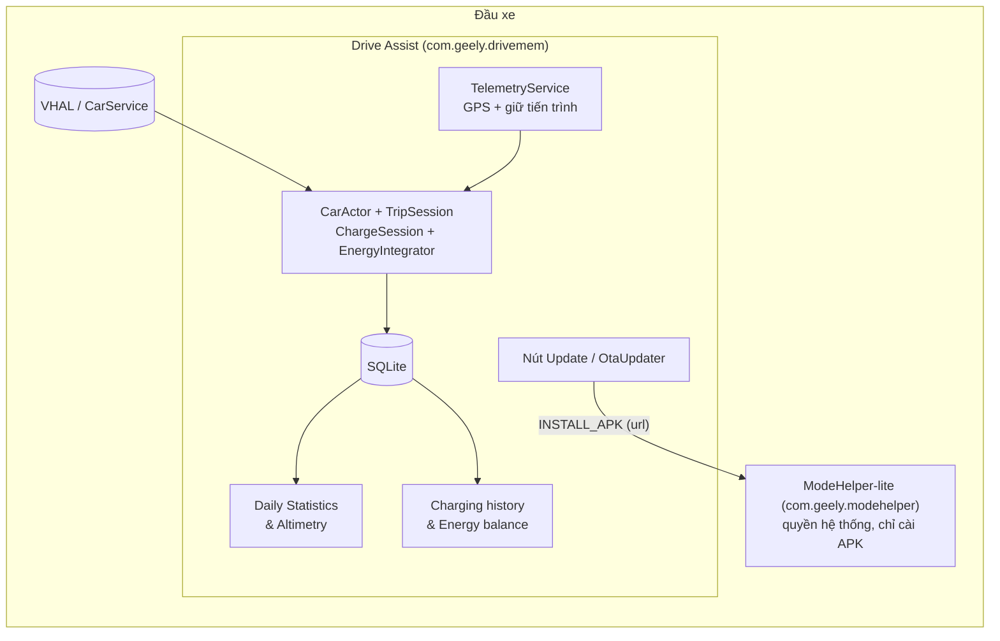
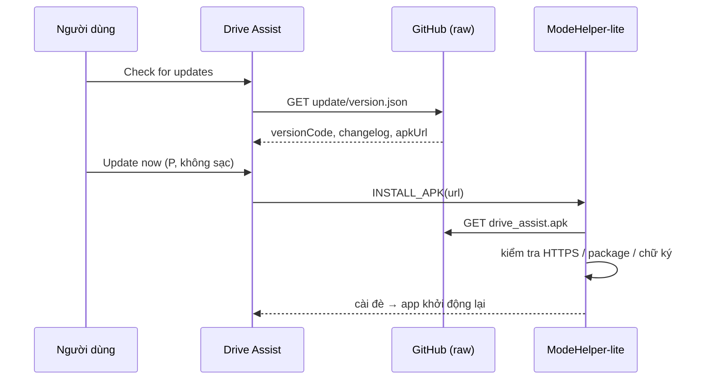

# Drive Assist — Stats-only

Bản **Drive Assist rút gọn** cho Geely EX2 (đầu xe IHU629G, Android 9), chỉ giữ hai màn hình thống kê và có **cập nhật OTA ngay trong app** qua repo này.

| | |
|---|---|
| Package | `com.geely.drivemem` (+ `com.geely.modehelper` bản lite để cài đặt im lặng) |
| Giao diện | Tiếng Anh |
| Đơn vị tiền | **VND** (`45,000 ₫`) |
| Cập nhật | OTA qua GitHub — bấm **Check for updates → Update now** |

---

## 1. Tổng quan

### Tính năng giữ lại
1. **Daily Statistics & Altimetry feed** — thống kê theo ngày/tuần/tháng: quãng đường, tiêu thụ & hiệu suất (kWh/100 km), pin & sạc, thời gian & tốc độ, danh sách chuyến đi/phiên sạc, và **độ cao** (Day Balance, Max Altitude, ascent/descent) lấy từ GPS.
2. **Charging history & energy balance** — lịch sử các phiên sạc (AC/DC, kWh, SoC, công suất), biểu đồ SoC theo thời gian, biểu đồ **Energy Balance** (Spent / Regen), đường cong công suất sạc, nhập chi phí từng phiên (VND), xuất ra USB.

### Đã gỡ bỏ
Điều khiển Clima, Gate, Turbo, Music/Spotify, panel Home Assistant, MQTT, ABRP, dashcam, overlay & icon thanh trạng thái, màn Cài đặt, xuất dữ liệu ra USB, nền skyline/Noturno.

> Lưu ý: không hỗ trợ OBD2, nên điện năng được ước tính theo SoC (không đo trực tiếp từ BMS) và các biểu đồ cần OBD2 (tiêu thụ theo tốc độ, quãng đường theo giờ & tốc độ) đã được lược bỏ khỏi giao diện.


### Bố cục màn hình (sơ đồ minh họa)
```
┌────┬───────────────────────────────────────────────┐
│ ▮  │                                               │
│ 📊 │   Daily Statistics  /  Charging history       │
│ ⚡ │   (nội dung đổi theo nút bên trái)            │
│    │                                               │
│ ⬇  │                                               │
└────┴───────────────────────────────────────────────┘
 thanh bên:  📊 Daily Statistics   ⚡ Charging history   ⬇ Update (OTA)
```

### Kiến trúc


---

## 2. Cài đặt (làm 1 lần)

Yêu cầu: xe đang bật ADB/USB hoặc có cách chạy file APK trên đầu xe.

1. Lấy file `install/drive_assist_installer.apk`.
2. Cài và chạy nó:
   ```bash
   adb connect <ip-xe>:5555          # nếu dùng ADB qua mạng
   adb install install/drive_assist_installer.apk
   adb shell monkey -p com.geely.installer 1   # hoặc mở "Drive Assist Setup" trên xe
   ```
3. Installer (ký bằng platform key) tự động: cài **ModeHelper-lite** → cài **Drive Assist** → mở app → **tự gỡ chính nó**.
4. Có thể cài đè lên bản Drive Assist cũ (cùng package & chữ ký) — dữ liệu lịch sử được giữ lại.

> ModeHelper-lite thay thế ModeHelper bản đầy đủ nếu có (mất: nhớ drive-mode/regen, dashcam, quản lý ADB/Wi-Fi).

---

## 3. Cập nhật trên xe (OTA)

1. Xe ở số **P** và **không đang sạc**.
2. Mở Drive Assist → bấm nút **⬇** cuối thanh bên trái.
3. **Check for updates** → nếu có bản mới: xem changelog → **Update now**.
4. App tải & cài im lặng rồi tự khởi động lại.

App cũng tự kiểm tra tối đa 6 giờ/lần khi xe ở P và hiện hộp thoại nếu có bản mới.

Cơ chế: app đọc [`update/version.json`](update/version.json) → so `versionCode` → gửi URL APK cho ModeHelper-lite → ModeHelper tải về, kiểm tra **HTTPS + đúng package + đúng chữ ký bản đang cài** → cài bằng `PackageInstaller`.



---

## 4. Phát hành bản cập nhật (cho người phát triển)

Yêu cầu: `java`, `python3`, `git`, `curl`. `apktool` và `uber-apk-signer` được tải tự động lần đầu.

```bash
git clone https://github.com/giangchau95/drive_assist.git && cd drive_assist

# (sửa mã trong src/ nếu cần) rồi:
tools/release.sh "Mô tả thay đổi của bản này"

git add -A
git commit -m "release: <mô tả ngắn>"
git push
```

`tools/release.sh` sẽ:
1. Đặt `versionCode` = số phút kể từ epoch (luôn tăng) và `versionName` = `1.0.0-stats-<versionCode>`.
2. Build `src/` bằng apktool, ký bằng `keystore/debug.ks` (alias `d`, mật khẩu `android`).
3. Ghi `update/drive_assist.apk` và `update/version.json` (kèm changelog).

Ngay sau khi `git push`, bấm **Check for updates** trên xe là thấy bản mới (raw.githubusercontent có thể trễ vài phút do cache).

### Quy tắc quan trọng
- **Luôn ký bằng đúng `keystore/debug.ks`.** Đổi khóa ⇒ không cài đè được, phải gỡ cài lại và mất dữ liệu.
- Repo phải **Public**, nhánh `main` (đường dẫn nằm trong app: `OtaUpdater.REPO_RAW`).
- `versionCode` của bản mới phải **lớn hơn** bản đang cài (script lo việc này).
- Không phát hành khi chưa kiểm tra: một APK lỗi sẽ được đẩy tới xe qua OTA.

---

## 5. Gỡ cài đặt hoàn toàn

Có **2 package** (installer đã tự gỡ sau khi cài xong):

| Package | Vai trò |
|---|---|
| `com.geely.drivemem` | Drive Assist |
| `com.geely.modehelper` | ModeHelper-lite |

> ⚠️ Nếu chỉ gỡ Drive Assist bằng Cài đặt → Ứng dụng thì ModeHelper-lite **vẫn còn** (hai app độc lập). Hãy dùng một trong các cách dưới để gỡ cả hai.

### Cách 1 — Ngay trong app (khuyên dùng)
Xe ở số **P** → nút **⬇** → **Uninstall all** → xác nhận. ModeHelper sẽ gỡ lần lượt Drive Assist, installer (nếu còn) rồi chính nó.

> Cần ModeHelper-lite bản mới (có `UNINSTALL_ALL`). Nếu app báo *"ModeHelper is outdated"*, chạy lại `install/drive_assist_installer.apk` một lần.

### Cách 2 — ADB
```bash
tools/uninstall.sh [<ip-xe>:5555]
# tương đương:
adb uninstall com.geely.drivemem && adb uninstall com.geely.modehelper
```

### Còn lại gì sau khi gỡ?
Gỡ `com.geely.drivemem` xóa **toàn bộ dữ liệu của app** (database thống kê, cài đặt, báo thức watchdog). App không sửa `/system` hay cài đặt hệ thống nào. Thứ duy nhất có thể còn: **file bạn tự xuất ra USB** (Export to USB ghi vào thư mục gốc của USB) — xóa tay nếu không cần.

---

## 6. Xử lý sự cố

| Hiện tượng | Cách xử lý |
|---|---|
| "Blocked: vehicle is not in Park / charging" | Về số P, đợi sạc xong rồi thử lại |
| "ModeHelper is not installed" | Chạy lại `install/drive_assist_installer.apk` |
| "Could not check: HTTP 404" | Repo chưa public / chưa có `update/version.json` trên nhánh `main` |
| Báo "Still not updated" sau 90 giây | Cài thất bại — thử lại; xem `adb logcat -s ModeHelper` |
| Cài đè báo lỗi chữ ký | APK không ký bằng `keystore/debug.ks` |
| "ModeHelper is outdated" khi Uninstall all | Chạy lại installer một lần để cập nhật ModeHelper-lite |

---

## 7. Cấu trúc repo

```
update/       version.json + drive_assist.apk   (app đọc từ đây)
install/      drive_assist_installer.apk + modehelper_lite.apk
src/          project apktool của app (smali + res)
java-src/     mã Java của các lớp đã viết lại (tham khảo)
tools/        release.sh, uninstall.sh
keystore/     debug.ks (khóa ký)
```

Giấy phép: dựa trên Drive Assist gốc, theo **GNU GPL v3** (xem [LICENSE](LICENSE)). Bản phân phối đã chỉnh sửa phải giữ mã nguồn mở theo GPLv3 — `src/` và `java-src/` trong repo này là phần mã nguồn tương ứng.
